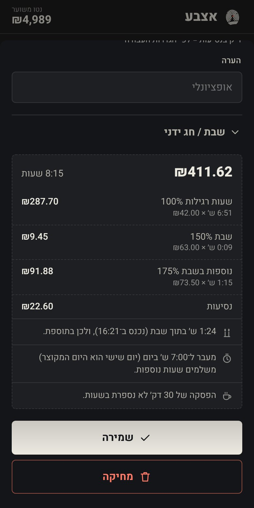

  

<h1 align="center">אצבע · Etzba</h1>

  Shift tracker and pay calculator for hourly workers in Israel. 
  Tap in when the shift starts, tap out when it ends, and see your pay by Israeli labour law.

  <a href="https://etzba.ilanox.dev">Website</a> ·
  <a href="https://etzba.ilanox.dev/app/">Open the web app</a> ·
  <a href="https://etzba.ilanox.dev/privacy.html">Privacy</a>

  &nbsp;
  &nbsp;
  &nbsp;
  

---

## Features

- **Live shift clock.** One tap to start, pay adds up as you work, and the start time can be fixed afterwards.
- **Pay by the law.** 125% and 150% overtime (daily and weekly, adjustable limit), short days, night shifts, unpaid breaks, Shabbat and holidays by candle-lighting and havdalah times per city, election day at 200%.
- **Gross to net.** Income tax with credit points, National Insurance, health tax and pension, by week, month and year.
- **Several jobs.** Each with its own pay, travel and rules.
- **Import and export.** Excel and CSV files, including straight from Android's share menu; CSV export and full backups.
- **Know your rights.** What hourly workers are owed, in plain words.
- **Home-screen widget.** Three sizes, with the dial as a clock-in button, the running time, pay so far and progress to overtime.
- **Notifications during a shift.** When overtime or Shabbat starts, and if you forgot to clock out.
- **Hebrew and English.** Right-to-left throughout, with a translation system for more languages.

## Principles

- **Private.** No account, no server, no ads, no analytics. Everything is stored on the phone.
- **Offline first.** Holidays and Shabbat times are calculated on the device; all yearly figures are built in.
- **Updatable without a release.** Yearly figures and translations are refreshed once a day from the website when online, and only used if newer and valid.

## Get it

- **On the web:** [etzba.ilanox.dev/app](https://etzba.ilanox.dev/app/). It installs to the home screen and works offline.
- **Android:** coming soon to Google Play.

Free, with no account and no ads.

## Good to know

Pay figures are an estimate based on Israeli labour law and the settings you enter. They are not an official payslip, and not legal, tax or financial advice. A collective agreement or personal contract may set different terms. Read the [privacy policy](https://etzba.ilanox.dev/privacy.html).

---

  Made by <a href="https://github.com/Ilanox">Ilan Levy (Ilanox)</a> · An Edvin Studios Project 
  <a href="mailto:ilan@edvin.co.il">ilan@edvin.co.il</a>

