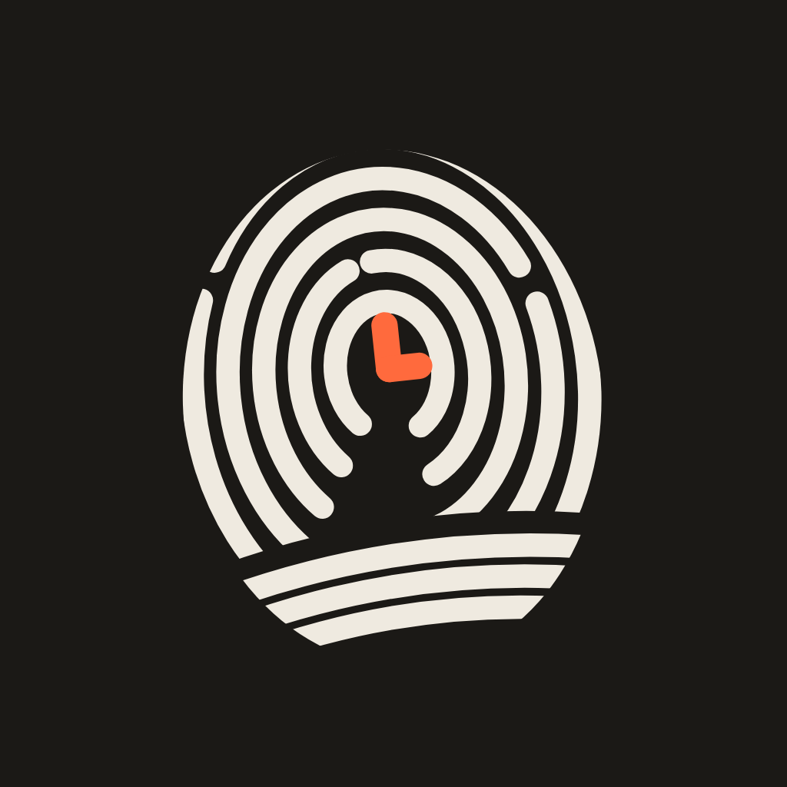
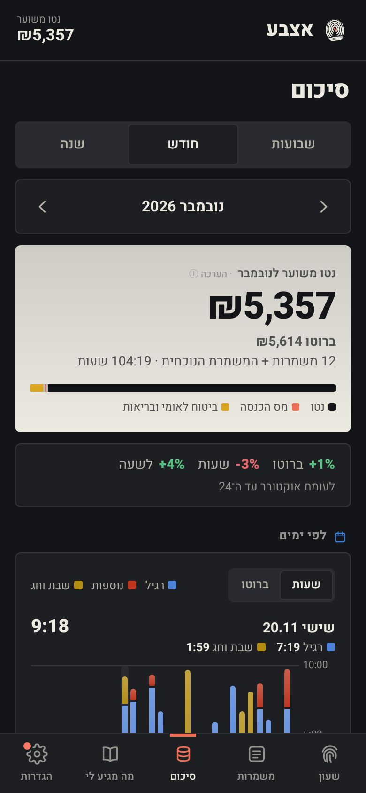

  

<h1 align="center">אצבע · Etzba</h1>

  Shift tracker and pay calculator for hourly workers in Israel. 
  Tap in when the shift starts, tap out when it ends, and see your pay by Israeli labour law.

  <a href="https://etzba.co.il">Website</a> ·
  <a href="https://etzba.co.il/app/">Open the web app</a> ·
  <a href="https://etzba.co.il/privacy">Privacy</a>

  &nbsp;
  &nbsp;
  &nbsp;
  

---

## What it does

- **Live shift clock.** One tap to start, pay adds up as you work. After clocking out you can add tips, edit or undo.
- **Pay by the law.** 125% and 150% overtime, night shifts, unpaid breaks, Shabbat and holidays by your city's times, election day, and special shifts at one rate.
- **Gross to net.** Income tax with credit points, National Insurance, health tax and pension.
- **Tips, travel and leave.** Tips your way, travel paid once a day, sick days, vacation and recuperation pay (דמי הבראה), with balances.
- **Pay goals.** Set a monthly target and see how many shifts are left to reach it, including Shabbat and holiday shifts.
- **Planned shifts.** Add upcoming shifts and get a reminder before they start.
- **Monthly report.** A PDF with every shift and the pay breakdown, ready to compare with your payslip.
- **Your year in אצבע.** A yearly recap with an image to share.
- **Several jobs.** Each with its own pay, travel and rules.
- **Import and export.** Excel and CSV files, and full backups.
- **Know your rights.** What hourly workers are owed, in plain words.
- **Home-screen widget.** Three sizes and styles; clock in straight from it.
- **Hebrew and English.** Right-to-left throughout.

## Private

No account, no ads, no analytics. Everything stays on your phone and works offline.

## Get it

- **On the web:** [etzba.co.il/app](https://etzba.co.il/app/). It installs to the home screen and works offline.
- **Android:** coming soon to Google Play.

Free, with no account and no ads. If it helps you, you can support it from inside the app and get extra themes, icons and early access to new features.

## Good to know

Pay figures are an estimate based on Israeli labour law and the settings you enter. They are not an official payslip, and not legal, tax or financial advice. A collective agreement or personal contract may set different terms. Read the [privacy policy](https://etzba.co.il/privacy).

---

  Made by <a href="https://github.com/Ilanox">Ilan Levy (Ilanox)</a> · An Edvin Studios Project 
  <a href="mailto:ilan@edvin.co.il">ilan@edvin.co.il</a>

