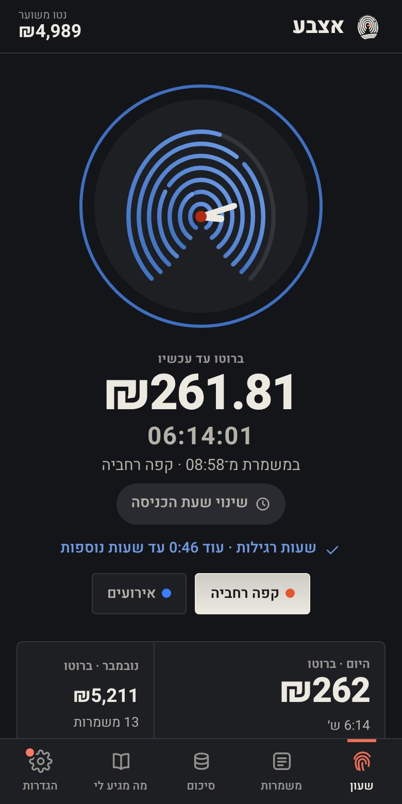
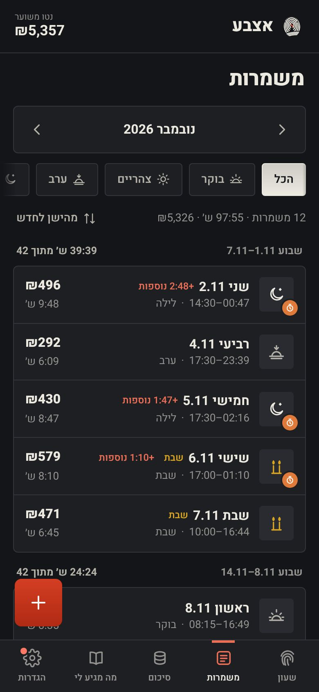

<p align="center">
  
</p>

<h1 align="center">אצבע · Etzba</h1>

<p align="center">
  Shift tracker and pay calculator for hourly workers in Israel.<br>
  Tap in when the shift starts, tap out when it ends, and see your pay by Israeli labour law.
</p>

<p align="center">
  <a href="https://etzba.ilanox.dev">Website</a> ·
  <a href="https://etzba.ilanox.dev/app/">Open the web app</a> ·
  <a href="https://etzba.ilanox.dev/privacy.html">Privacy</a>
</p>

<p align="center">
  &nbsp;
  &nbsp;
  &nbsp;
  
</p>

---

## Features

- **Live shift clock.** One tap to start, pay adds up as you work, and the start time can be fixed afterwards.
- **Pay by the law.** 125% and 150% overtime (daily and weekly, adjustable limit), short days, night shifts, unpaid breaks, Shabbat and holidays by candle-lighting and havdalah times per city, election day at 200%.
- **Gross to net.** Income tax with credit points, National Insurance, health tax and pension, by week, month and year.
- **Several jobs.** Each with its own pay, travel and rules.
- **Import and export.** Excel and CSV files, including straight from Android's share menu; CSV export and full backups.
- **Know your rights.** What hourly workers are owed, in plain words.
- **Home-screen widget.** Three sizes, with the dial as a clock-in button, the running time, pay so far and progress to overtime.
- **Notifications during a shift.** When overtime or Shabbat starts, and if you forgot to clock out.
- **Hebrew and English.** Right-to-left throughout, with a translation system for more languages.

## Principles

- **Private.** No account, no server, no ads, no analytics. Everything is stored on the phone.
- **Offline first.** Holidays and Shabbat times are calculated on the device; all yearly figures are built in.
- **Updatable without a release.** Yearly figures and translations are refreshed once a day from the website when online, and only used if newer and valid.

## Tech

Vanilla JavaScript ES modules, no framework and no bundler. Android through [Capacitor 8](https://capacitorjs.com) with a few native Java plugins (share-to-app, widget, app actions). Tested with Node's test runner and Playwright.

| Path | Contents |
|---|---|
| `index.html`, `style.css` | the app shell and all styling |
| `js/app.js` | screens, settings, import/export, notifications, widget sync |
| `js/pay-engine.js` | pay rules: overtime, Shabbat, holidays, election day, weekly limit, breaks |
| `js/hebrew-calendar.js` | Jewish holidays and Shabbat times per city |
| `js/net-pay.js` | gross to net: income tax, National Insurance, health tax, pension |
| `js/rules.js`, `data/rules.json` | yearly figures, built in and updated online |
| `js/translate.js`, `js/remote-packs.js`, `languages/` | translation engine, online pack updates, language packs |
| `js/native-bridge.js` | everything that talks to Android |
| `js/file-reader.js`, `js/shift-import.js` | reading .xls/.xlsx/.csv and turning rows into shifts |
| `native/android/` | Java plugins, widget, Android resources |
| `site/` | the home page at etzba.ilanox.dev |
| `store/` | Google Play listing, screenshots and the generator for them |
| `tests/` | `unit/` and `e2e/` |
| `scripts/` | build, Android setup, release, install, logs, data |
| `features.json` | build switches: `widget`, `arrivalDetection`, `devTools` |

## Getting started

Requires [Node.js 22+](https://nodejs.org). For Android also [Android Studio](https://developer.android.com/studio) and JDK 21.

```bash
npm install
npm start            # the web app at http://localhost:5173 (also prints an address for a phone on the same Wi-Fi)
```

### Android

```bash
npm run android:init     # first time: creates android/, plugins, icons, splash
npm run apk              # test build → etzba.apk
npm run install-apk      # install it on a phone over USB
npm run android          # rebuild and open Android Studio
```

### Commands

| Command | What it does |
|---|---|
| `npm start` | run the web app locally |
| `npm test` | unit tests (no packages needed) |
| `npm run test:e2e` | the app in a phone-sized browser, with a simulated Android bridge (`npx playwright install chromium` once) |
| `npm run apk` / `install-apk` | test build, and install it over USB |
| `npm run release` / `install-release` | signed Google Play build (`.aab` + `.apk`), and install it over USB |
| `npm run logs` | live log from the phone over USB (`-- --start` restarts the app first, `-- --verbose` shows everything) |
| `npm run data` | rebuild the downloadable language packs in `data/lang/` |
| `npm run check:translations` | list texts that aren't translated yet |

## Releasing

1. Set `"version"` in `package.json`; the Android version code is derived from it.
2. `npm run release`. The first run creates the upload key (`etzba-upload.jks`, `keystore.properties`), which is never committed. **Back it up**: updates can't be published without it.
3. Upload `etzba-<version>.aab` in Play Console. Listing texts, data-safety answers and the test checklist are in [`store/listing.md`](store/listing.md).

## Updates without a store release

| What | Source | How to publish |
|---|---|---|
| Yearly figures (minimum wage, tax tables, election days) | `data/rules.json` | edit, raise `version`, push; keep `BUILT_IN` in `js/rules.js` in step (`npm test` checks) |
| Translations | `languages/<code>.js` → `data/lang/<code>.json` | edit the pack, `npm run data`, push; the version rises by itself |

Phones check once a day when online. Anything else (screens, pay logic, the widget) needs a new release.

## Website

`.github/workflows/pages.yml` publishes **etzba.ilanox.dev** on every push to `main`:

- `/`: the home page (`site/`)
- `/app/`: the web app
- `/data/`: the downloadable data
- `/privacy.html`: the privacy policy

One-time setup: Settings → Pages → Source **GitHub Actions**, custom domain `etzba.ilanox.dev`.

## Translations

Every language is one file in `languages/`. See [`languages/README.md`](languages/README.md) for the format; `npm run check:translations` lists what's missing.

## Build switches

`features.json` decides what goes into the Android app:

- `widget`: the home-screen widget.
- `arrivalDetection`: workplace arrival notifications. It needs background location, which Google Play reviews separately, so it's off.
- `devTools`: the diagnostics and developer screens in Settings. Off for release.

## iOS (later)

Needs a Mac, Xcode and the Apple Developer Program.

```bash
npm i @capacitor/ios && npx cap add ios && node scripts/native-setup.mjs && npx cap sync ios
```

---

<p align="center">
  Made by <a href="https://github.com/Ilanox">Ilan Levy (Ilanox)</a> · An Edvin Studios Project<br>
  <a href="mailto:ilan@edvin.co.il">ilan@edvin.co.il</a>
</p>
